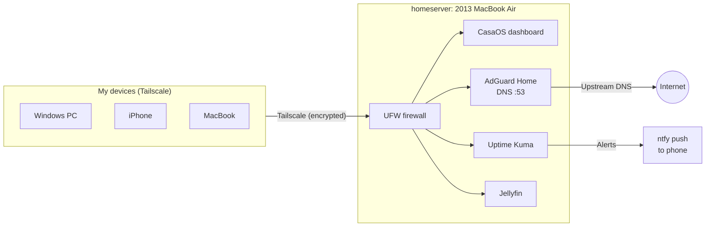

# Old MacBook, New Job: a 2013 MacBook Air Homelab

I had a 2013 MacBook Air sitting in a drawer. Apple stopped supporting it years ago, it was stuck on an old macOS, and most people would have recycled it. I wanted to see what it could still do.

Over one weekend I turned it into a 24/7 home server that blocks ads for every device I own, monitors itself, alerts my phone when something breaks, and is reachable securely from anywhere. It cost me one $10 USB drive.

**Obsolete doesn't mean useless.** An 8 GB laptop from 2013 has more than enough power for a modern homelab.


## Why do this?

- **It was already here.** I wanted to do the whole thing for $0, using only what I already had. No new hardware, not even a USB drive (at first).
- **E-waste is real.** Old laptops still work fine; they just stop getting updates. Putting Linux on one gives it a second life.
- **A laptop is a good server.** It's quiet, sips power (about 2–3 W idle), and the battery works as a built-in UPS when the power blips.
- **It's fun.** Getting old Apple hardware to play nice with Linux turned into a puzzle.

## Before and after

<p align="center">
  
  
</p>
<p align="center"><i>Before: stuck on Mountain Lion. After: a homelab dashboard.</i></p>

| | |
|---|---|
| **Hardware** | 2013 MacBook Air: Intel Core i5, 8 GB RAM, 256 GB SSD |
| **Before** | OS X Mountain Lion, unsupported for years |
| **After** | Ubuntu Server 26.04 LTS (headless, lid closed, screen off) |
| **Networking** | Wi‑Fi (Broadcom BCM4360), Tailscale mesh VPN |
| **App platform** | CasaOS (Docker) |
| **Services** | AdGuard Home, Uptime Kuma, Jellyfin |
| **Security** | UFW firewall, nothing exposed to the internet, remote access over Tailscale only |
| **Load with everything running** | ~2% CPU, ~30% RAM, ~5% disk, 47–53 °C |

## What it does now

- **Ad and tracker blocking everywhere:** AdGuard Home is the DNS server for every device on my Tailscale network, so ads get blocked at home *and* on my phone's mobile data.
- **Monitoring and alerts:** Uptime Kuma checks the internet and each service every 60 seconds and pushes a notification to my phone (via ntfy) if anything goes down.
- **Access from anywhere:** Tailscale gives the server a permanent private address. SSH and every web app work from my PC or phone without opening a single port on my router.
- **Media server:** Jellyfin is ready for a personal movie and TV library.

## Architecture



## Build log

Old hardware fights back. Most of this project was troubleshooting, which was the fun part.

### 1. Getting Linux onto the Mac (it took a few tries)

My goal was to make this project **completely free**, so at first I deliberately tried it with no USB drive or other external storage. The plan was to copy the installer onto a partition of the Mac's own SSD and boot from that.

- **Attempt 1, Ubuntu Server from the internal drive:** the installer can't install onto the disk it's running from, so it reported *"Block probing did not discover any disks."*
- **Attempt 2, Debian netboot:** booted fine, but couldn't use my iPhone for internet, and the Mac has no Ethernet port.
- **Attempt 3, balenaEtcher:** once I had a USB drive, Etcher threw an error on my newer Mac.

<p align="center">
  
  
  
</p>

After a few dead ends, I decided $10 was worth it. **What worked:** a USB drive written with **Rufus** (GPT, DD mode). The installer got internet through **iPhone USB tethering**, and I installed to the full Apple SSD with LVM and OpenSSH enabled. Afterward I grew the volume to use the whole disk (Ubuntu only uses about 100 GB by default):

```bash
sudo lvextend -r -l +100%FREE /dev/ubuntu-vg/ubuntu-lv
```

<p align="center">
  
</p>

### 2. Making 2013 Wi‑Fi work

- The Broadcom BCM4360 card has no working driver out of the box. The default `b43` driver fails on boot with `FOUND UNSUPPORTED PHY`.
- With the iPhone still tethered, I enabled the `restricted` and `multiverse` repositories and built Broadcom's `wl` driver (`broadcom-sta-dkms`).
- Configured Wi‑Fi with Netplan (`/etc/netplan/50-wifi.yaml`, permissions `600`).
- **Troubleshooting:** the interface stayed `NO-CARRIER / DORMANT`. `journalctl` showed `wpa_supplicant` scanning but never joining, which turned out to be a typo in the passphrase. Once fixed, it got an IP.

<p align="center">
  
  
</p>

### 3. Turning a laptop into a server

- Lid closed, still running: `HandleLidSwitch=ignore` in `logind.conf`.
- Screen backlight turned off at boot with a root cron job, to save power and heat.
- **Troubleshooting:** when the server "went offline," I read `/sys/class/power_supply/ADP1/online` and got `0`. It was a loose MagSafe plug, and the battery (61%) had kept the server alive the whole time. After reseating it, the value was back to `1`.

<p align="center">
  
</p>

### 4. Remote access with Tailscale

My ISP's router doesn't support DHCP reservations, so the server's local IP could change. Tailscale gives it a permanent `100.x` address plus encrypted access from anywhere, even from my phone.

<p align="center">
  
</p>

### 5. Apps with CasaOS and Docker

A bare-metal Pi-hole install kept hanging on dependencies, so I switched to **CasaOS** for one-click Docker apps.

<p align="center">
  
  
</p>

**Troubleshooting along the way:**
- **Port conflict:** AdGuard wanted port 3001, which Uptime Kuma already had. I remapped AdGuard's web UI.
- **Port 53 in use:** freed it for AdGuard by disabling the `systemd-resolved` stub listener.
- **Containers couldn't resolve DNS** (`EAI_AGAIN`), so Uptime Kuma couldn't send alerts. I fixed it by setting DNS servers in `/etc/docker/daemon.json` and turning off Tailscale DNS on the server itself, which also prevents a DNS loop.

### 6. Locking it down

- UFW: deny all incoming by default, allow only the `tailscale0` interface and the local subnet.
- No port forwarding on the router, so nothing is exposed to the public internet.

## Proof it works

Querying AdGuard directly for a known ad domain returns `0.0.0.0`, so it's blocked:


From a device on Tailscale, the ad domain doesn't resolve at all while normal sites load fine:

```text
> ping doubleclick.net
Ping request could not find host doubleclick.net.

> ping google.com
Reply from ...: time=30ms
```

## What I learned

Linux server administration · Linux drivers and kernel modules (DKMS) · Netplan and Wi‑Fi configuration · DNS and DNS troubleshooting · Docker networking · VPN and mesh networking · Host firewalls (UFW) · Service monitoring and alerting · Log analysis with `journalctl`

And the bigger lesson: **check the drawer before you buy new hardware.** Plenty of "obsolete" devices are one OS install away from being useful again.

## Next steps

- [ ] SSH key authentication and disable password login
- [ ] Automated backups of app data
- [ ] External drive for Jellyfin media storage
- [ ] Analyze AdGuard query logs for tracker and device behavior
